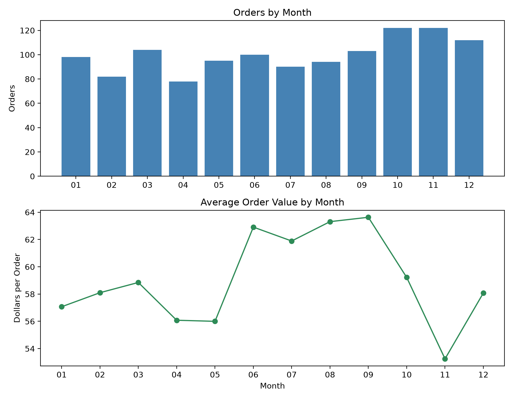

# Retail Sales Analysis

I built this project to practice using SQL and Python with business data. I'm a mathematics student at Bryn Mawr College, and I've been interested in finding ways to apply what I'm learning to business questions.

For this project, I worked with a simulated retail sales dataset containing 1,200 orders from 2025. I wanted to see how revenue changed throughout the year, which products performed best, and whether the categories bringing in the most revenue were also the most profitable.

## What I did

I used SQL to look at:
- Monthly revenue and number of orders
- Month-over-month revenue growth
- Average order value
- Sales by product category and region
- Best-selling products
- Gross profit and profit margins

I also used Python and Matplotlib to create a dashboard showing monthly order volume and average order value.

## What I found

Across the year, the dataset had $70,765.09 in revenue and $38,937.79 in gross profit.

One thing that stood out to me was the drop in sales between March and April. Revenue fell by 28.54%, but when I looked at the number of orders and average order value separately, I found that the decrease was mostly related to fewer orders. There were 104 orders in March compared to 78 in April, while average order value only fell from $58.85 to $56.08.

I also thought the difference between revenue and profit margins was interesting. Electronics generated the most revenue at $30,014.79, but Office had the highest gross profit margin at 64.25%. This was a good example of why revenue alone doesn't tell you which part of a business is performing most efficiently in terms of gross margin.

Another thing I noticed was that October and November both had 122 orders, but November brought in less revenue. Average order value dropped from $59.22 to $53.25, so the difference wasn't coming from the number of orders.

## Dashboard

The first chart shows the number of orders each month. The second shows average order value over the same period.



## Tools

- Python
- SQL (SQLite)
- Matplotlib
- CSV

## How to run it

First, run the SQL analysis:

```bash
python3 analyze.py
```

Install Matplotlib if you don't already have it:

```bash
python3 -m pip install matplotlib
```

Then create the dashboard:

```bash
python3 business_dashboard.py
```

The SQL results are saved as CSV files in the `outputs` folder, along with the dashboard image.


## About the data

This project uses simulated data rather than real sales records. I used it to practice writing queries, working with Python, and figuring out what different business metrics can tell me.
